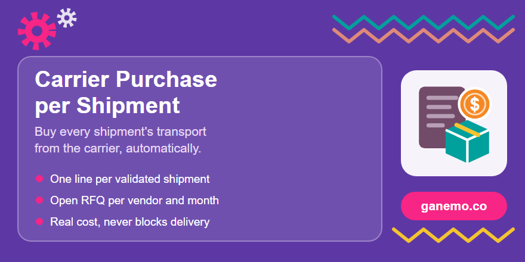

**Carrier Purchase per Shipment** (`delivery_carrier_purchase`)

**Author**: [Ganemo](https://www.ganemo.com)

Pay the carrier for every shipment, at its real cost. When a shipment to a customer (warehouse
delivery or dropship) is validated, the module adds a **purchase order line** for the transport to
the vendor set on the shipping method, **even if shipping is free for the customer**. Lines are
gathered in an open request for quotation per vendor and month, so the carrier bill can be checked
against the purchase.

It is **off until enabled**.

## Configuration

1. *Inventory > Configuration > Settings > Shipping*: tick **Purchase Transport per Shipment**
   (per company) and choose **Group Transport Purchases**:

   | Option | Result |
   |---|---|
   | One request for quotation per vendor and month (default) | One line per shipment in the open RFQ of the vendor for the month. |
   | ... per week / per day | Same, with a shorter period. |
   | One purchase order per shipment | Each shipment gets its own purchase order. |

   Once an RFQ is confirmed, the next shipments of that vendor and period go to a new one.

2. *Inventory > Configuration > Delivery > Shipping Methods*, tab **Transport Purchase**:

   | Field | Use |
   |---|---|
   | **Transport Vendor** | Who is paid for the shipments of the method (the carrier, or the agency that bills it). Empty: nothing is bought. |
   | **Transport Cost** | **Shipment cost**: what an integrated carrier returns when the shipment is created; for fixed price and rule based methods, the price computed with the real destination (the recipient of a dropship) and weight. **Fixed cost**: the amount below for every shipment. **Vendor price list**: the vendor price of the purchase product. |
   | **Transport Fixed Cost** | Amount per shipment, in the company currency (cost type *Fixed cost*). |
   | **Transport Purchase Product** | Product of the lines. Empty: the delivery product of the method. |

3. **Avoid a double purchase.** If the delivery product still has **Purchase Automatically**
   (`service_to_purchase`), a warning banner appears in the settings and on the shipping method
   form: switch it off. As a transition guard, a sale whose delivery product already created the
   purchase does not get a second one.

## What happens on a shipment

- Validating the delivery (from the warehouse or as a dropship) adds **one line per shipment**.
- The line description holds the method and transfer name, the **tracking reference** (updated if it
  arrives later), the destination zip, city and country, the weight and the sale order, in the
  language of the vendor.
- Links both ways: **Transport** smart button on the transfer, **Shipments** smart button on the
  purchase order, and the shipments on the purchase line.

## Safety

- **Never blocks the validation.** If the cost cannot be obtained, the line is created at 0 with a
  note on the transfer and on the purchase. If the line cannot be created, an activity asks to
  create it by hand and the **Create Transport Purchase** button is available.
- **Cancellation never deletes.** Cancelling the shipment at the carrier, or the **Cancel Transport
  Purchase** wizard (reason required), sets the price to 0 and starts the description with
  `CANCELLED: reason`. A line already billed is left untouched with a message: ask the vendor for
  a credit note.

## Works with

- `delivery_sendcloud_dropship`: with its simulation, the price returned by the carrier is captured
  as the cost of the line.
- Depends on `purchase_stock`, `sale_purchase` and `stock_delivery_dropship`.

## Demo data

Installed only with demo data:

- **GLS Economy Parcel**: rules by weight, free for the customer, vendor *General Logistics
  Systems Spain*, cost *Shipment cost*.
- **Palletways · Pallet 24/48h**: cost from the vendor price list (48.50), vendor *Palletways Iberia*.
- **Missatgeria Vallès 24h** (regional courier of the dropship demo): fixed cost 6.40.
- Dropship sales for the festival customer, confirmed and ready to validate. Validate them and open
  the RFQ of each vendor.

## Tests

`tests/test_carrier_purchase.py`.

## Producer product and manifest

- **Producer**: Ganemo (Odoo 18, Ganemo logistics line, repo `odoo_logistics`).
- **Manifest**: version `18.0.1.0.0`, depends on `purchase_stock`, `sale_purchase` and `stock_delivery_dropship`, license `OPL-1`, price USD 69.0, not an application. Name, dependencies and data files are declared in `__manifest__.py`.
- **Translations**: English and Spanish (`i18n/`).

## Cross-references

- Related modules: `delivery_sendcloud_dropship` (Sendcloud), `delivery_status_tracking` (delivery states), `stock_delivery_dropship`.
- Store page and support: [ganemo.com](https://www.ganemo.com) · help desk `ayuda@ganemo.com` · sales `leads@ganemo.com`.
