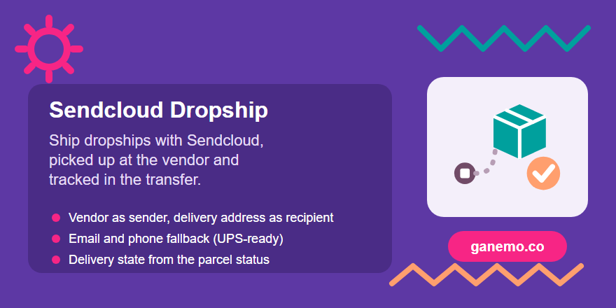

# **Sendcloud: dropship shipments and delivery states** (`delivery_sendcloud_dropship`)

**Author**: [Ganemo](https://www.ganemo.com)

Works with Sendcloud. Odoo 18 Enterprise.

Extends the official Sendcloud connector (`delivery_sendcloud`, Enterprise) in four points, and
adds a simulation of the Sendcloud API for demos and training (point 5).

## 1. Dropship with pickup at the vendor

The official connector takes the recipient from the transfer contact and the sender from the
warehouse of the operation type. In a dropship those are the vendor and nothing, so the parcel
cannot be created. With this module, when a dropship is validated with a Sendcloud method:

- **recipient** = the purchase delivery address (`stock_delivery_dropship`);
- **sender** = the vendor, sent as `from_*` fields, without `sender_address` (Sendcloud does not
  accept both);
- the rate is computed with the vendor country.

The transfer is never written: the connector receives a read-only view of the picking with those
parties (`models/sendcloud_service.py`, `_Overlay`). No connector code is copied.

## 2. Email and phone of the recipient

Carriers such as UPS reject parcels without the recipient email, and delivery addresses often
have none. When the recipient (or the vendor) has no email or phone, they are taken from its
company, then from the customer of the sale order (for the vendor, from the company of the
transfer). The contacts are not modified.

## 3. Options on the shipping method (Sendcloud tab)

| Field | Use |
|---|---|
| **Sendcloud Contract ID** | Id of the carrier contract in Sendcloud (*Shipping > Carriers > My contracts*). Sent in every parcel, so the parcel uses that contract instead of the default one of the carrier. Empty = Sendcloud default. |
| **Sender Address from Odoo** | For non-dropship transfers, send the warehouse address as sender instead of looking for a Sendcloud sender address whose label or contact name equals the warehouse name. |

## 4. Delivery state (`delivery_status_tracking`)

Implements the `sendcloud_get_delivery_state` hook: the scheduled action *Delivery Status
Tracking: ask the carriers* and the *Update* button read the parcel status (`GET parcels/{id}`)
and set the delivery state of the transfer through its technical code:

| Sendcloud status ids | Code |
|---|---|
| 999, 1001, 1000, 1, 13 | `recorded` |
| 22, 3, 5, 6, 7, 62990, 62989, 91, 92, 4, 62993, 62994, 62995, 12 | `in_transit` |
| 11, 93 | `delivered` |
| 8, 80, 62991, 62992, 62996, 62997, 1002, 15, 94 | `incident` |
| 2001, 1999, 1998, 2000 | `canceled` |
| 1337 (unknown) and any other | unchanged |

«Announced: not collected» (13) is the normal first status of many carriers, not an alarm.

## 5. Simulation of the Sendcloud API (demos and training)

With **Simulate Carrier Integration** ticked on the shipping method (field of
`delivery_status_tracking`, with its **Simulated Tracking Prefix**), the whole connector works
**without connecting to Sendcloud**; no request leaves the server:

- **Products**: *Load your products* lists a simulated catalog (UPS Standard, GLS Business Parcel,
  Correos Express Paq 24), plus the product already chosen in the method.
- **Rates**: a simulated price per parcel (converted to the company currency).
- **Parcel**: validating the transfer creates the parcel with a **PDF label** attached to the
  transfer and a **tracking number** (the method prefix followed by digits).
- **Cancellation**: *Cancel Shipment* answers as Sendcloud does and sets the state to cancelled.
- **Statuses**: each *Update* (or the scheduled action) moves the parcel through the real Sendcloud
  status codes: **1000** *Ready to send* (recorded), **22** *picked up* (in transit), **11**
  *Delivered* (delivered). It stays delivered afterwards.
- **Tracking link**: built from the **tracking URL of the shipping method** (with
  `<shipmenttrackingnumber>`); there is no Sendcloud page in simulation.

Only for demos and training: **never enable it in production**.

## Demo data

Installed only with demo data (it also uses the data of `stock_delivery_dropship` and
`delivery_status_tracking`):

- Shipping methods **Sendcloud · UPS Standard** (prefix `1Z999AA1`, UPS tracking page) and
  **Sendcloud · GLS Business Parcel** (sender address from Odoo), both in simulation and **free for
  the customer** (*Free if order amount is above* 0).
- A sale to **Bistrot du Port** (France) with **Sendcloud · UPS Standard**, with its purchase
  confirmed: a **dropship picked up at the vendor**, ready to validate.
- A delivery from the warehouse to **Hotel Mirador del Port** with **Sendcloud · GLS Business
  Parcel**, ready to validate.

Validate them and press *Update* to see label, tracking number and states without any Sendcloud
account.

## Configuration notes

- Set **Print Label** on the *Dropship* operation type (visible with `stock_delivery_dropship`).
- `sendcloud_shipping_id` is computed from the method country: changing the country of the method
  clears the shipping product, which then has to be loaded again (*Load your products*).
- With *Production environment* off, the official connector cancels every parcel right after
  creating it (test mode).

## Tests

- `tests/test_sendcloud_dropship.py` (standard): the Sendcloud API is mocked and the exact parcel
  payload is checked — dropship from the vendor to the delivery address with contract and email
  fallback, sender data fallback, outgoing with Sendcloud sender address and with sender from
  Odoo, no contract, and the delivery state mapping (button, scheduled action and cancellation);
  the simulation end to end with the network blocked (tracking number, parcel, rate, attached label,
  statuses, cancellation), the simulated product catalog, and the demo dropship (tracking number,
  tracking link, recorded state, free for the customer).
- `tests/test_official_regression.py` (tag `sendcloud_regression`, not standard): the official
  `delivery_sendcloud` tests run with this module installed. Three of them fail upstream in 18.0
  without this module too (`quantity_done`, `action_set_quantities_to_reservation`, missing weight).

## Module information

| | |
|---|---|
| Producer product | Ganemo (module `delivery_sendcloud_dropship`, Odoo 18) |
| Depends on | `delivery_sendcloud` (Enterprise), `delivery_status_tracking`, `stock_delivery_dropship` |
| License | OPL-1 (Odoo Proprietary License v1.0), see `LICENSE.txt` |
| Price | USD 149.00 |
| Languages | English, Spanish |

## Cross-references

- Manifest: `__manifest__.py` (name, version, dependencies, license).
- Official connector extended: `delivery_sendcloud` (Odoo 18 Enterprise).
- Support: [ayuda@ganemo.com](mailto:ayuda@ganemo.com) · Sales: [leads@ganemo.com](mailto:leads@ganemo.com) · [www.ganemo.com](https://www.ganemo.com)

Sendcloud, UPS and GLS are trademarks of their respective owners; they are named only to describe compatibility.
