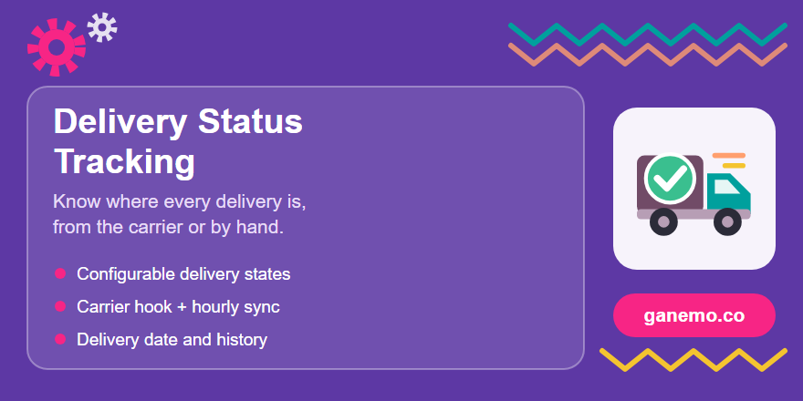

**Delivery Status Tracking – Carriers & Drivers** (`delivery_status_tracking`)



**Author**: [Ganemo](https://www.ganemo.com)

Know where every delivery is. Adds a **delivery state** to transfers — recorded by the carrier,
in transit, delivered, incident, cancelled — with its date and the carrier's own history, set
automatically by carrier integrations or by hand for carriers without one.

## Delivery states

*Inventory > Configuration > Delivery > Delivery States.* Each state has:

| Field | Use |
|---|---|
| Name, sequence, icon | How the state is shown (Font Awesome icon class, e.g. `fa-truck`). |
| **Technical code** | What the state means: `pending`, `recorded`, `in_transit`, `delivered`, `incident`, `canceled`. Integrations set the state through this code, so states can be renamed or translated freely. |
| Is result state / result type | Final outcome (success, partial, failure). When a transfer reaches a result state, its **delivery date** is stored. |
| Email template | Optional email to the transfer contact when the transfer enters the state. |

Five states are created on install (recorded, in transit, delivered, incident, cancelled).
States belong to a company; a company that needs a state it does not have gets its own copy.

## On the transfer

In *Additional Info > Shipping Information*: **Delivery State** (editable by hand), an
**Update** button for integrated carriers, the delivery date, the last carrier status, the
history and the error of the last automatic request. The list view has an optional column and
the search view a *Delivery State* grouping.

## For carrier integrations

A carrier integration implements, on `delivery.carrier`:

```python
def <delivery_type>_get_delivery_state(self, picking):
    return {'code': 'in_transit', 'message': 'Picked up by driver', 'data': {...}}
```

With that hook:

- sending the shipment sets **recorded**, cancelling it sets **cancelled**;
- the scheduled action *Delivery Status Tracking: ask the carriers* (hourly by default) asks
  every validated transfer that is not delivered or cancelled yet; an error on one transfer is
  stored on it and does not stop the others;
- an unknown status (`code` False) keeps the state and records the message.

`_set_delivery_state(code, message, data)` on the transfer does the same from any other source.

Implemented by `delivery_sendcloud_dropship` (Sendcloud).

## Simulation mode (demos and training)

*Inventory > Configuration > Delivery > Shipping Methods*, on the shipping method form (next to
the tracking URL):

| Field | Use |
|---|---|
| **Simulate Carrier Integration** (`delivery_simulation`) | Nothing is sent to the carrier: tracking numbers and statuses are fictitious. A yellow notice at the top of the form shows that simulation is on. |
| **Simulated Tracking Prefix** (`delivery_simulation_prefix`) | Start of the fictitious tracking numbers (default `SIM`), to make them look like the carrier's own (e.g. `1Z999AA1` for UPS). Only visible when simulation is on. |

For shipping methods **without their own integration** (fixed price or based on rules):

- validating a delivery to a customer gives it a fictitious tracking number (prefix + 10 digits;
  a number typed by hand is kept) and the **recorded** state;
- each **Update** (or the scheduled action) moves it one step forward: *in transit*, then
  *delivered* (it stays delivered afterwards), and the delivery date is stored;
- cancelling the shipment sets **cancelled** without calling anyone.

Carrier integrations that support it (e.g. `delivery_sendcloud_dropship`) simulate their own API
instead. Only for demos and training: **never enable it in production**.

## Demo data

Installed only with demo data:

- Real carriers in simulation, each with its public tracking page: **UPS Standard** (prefix
  `1Z999AA1`), **GLS Business Parcel**, **SEUR 24** and **Correos Express Paq 24**.
- Customers **Hotel Mirador del Port** and **Cafetería Plaça Nova**, and the product
  *Custom printed paper cup 8 oz*.
- Three delivery orders confirmed and ready to validate (Hotel Mirador with UPS Standard,
  Cafetería Plaça Nova with GLS Business Parcel, Hotel Mirador with SEUR 24). Validate one and use
  **Update** to see it go from recorded to delivered.

## Compatibility with the driver portal

The model (`stock.delivery.state`) and the transfer fields (`delivery_state_id`,
`delivery_date_done`) use the same names as Ganemo's driver portal (`stock_delivery_portal`),
so the portal can build on this module.

## Tests

`tests/test_delivery_status_tracking.py`: default states, state recorded on shipment, carriers
without hook, update and history, scheduled action skipping final states and surviving a
carrier error, cancellation, manual state with delivery date, email template, states of a
second company, simulation (full flow with prefix and tracking number, scheduled action and
cancellation, tracking number typed by hand kept) and demo deliveries ready to validate.


## Producer product and manifest

- **Producer**: Ganemo (Odoo 18, Ganemo logistics line, repo `odoo_logistics`). Common base for carrier integrations and the Ganemo driver portal.
- **Manifest**: version `18.0.1.1.0`, depends on `stock_delivery`, license `OPL-1`, price USD 79.0, not an application. Name, dependencies and data files are declared in `__manifest__.py`.
- **Translations**: English and Spanish (`i18n/`).

## Cross-references

- Carrier integration using it: `delivery_sendcloud_dropship` (Sendcloud).
- Consumer: Ganemo driver portal (`stock_delivery_portal`).
- Store page and support: [ganemo.com](https://www.ganemo.com) · help desk `ayuda@ganemo.com` · sales `leads@ganemo.com`.
