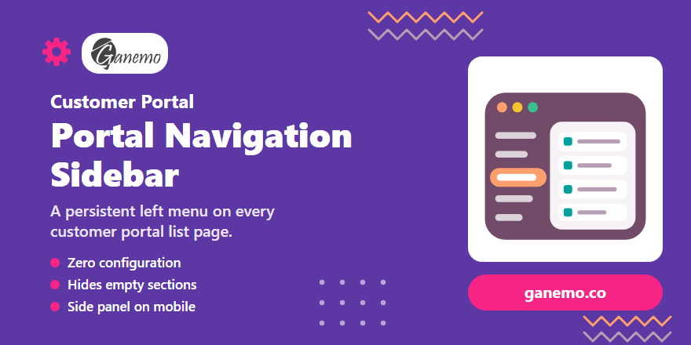

**Portal Navigation Sidebar**

**Author**: [Ganemo](https://www.ganemo.com)

## Overview

In the standard Odoo customer portal, opening a section (invoices, orders,
tickets, projects...) hides every other option: the only way to reach another
section is to go back to the portal home page and pick it again.

This module adds a **persistent navigation menu** to every portal list page:

- **Desktop:** a vertical menu on the left of the list.
- **Mobile:** a button with the current section opens the same menu as a
  panel from the left, so the list keeps the full screen width.

## Features

- **Zero configuration.** The menu shows the same options as the portal home
  page (`/my`), in the same order and grouped the same way. Install or
  uninstall an app and its option appears or disappears on its own.
- **Only what matters.** Sections without documents stay hidden, exactly like
  on the home page. The current section is always shown and highlighted.
- **Respects access rights.** Each user sees the options Odoo would show on
  their own home page.
- **On every portal page.** Lists of every app, custom portal pages and pages
  like *Payment methods* that Odoo draws outside the portal layout.
- **Out of the way where it is not needed.** It does not show on the home page
  (the cards already are the menu), on a document page (it has its own panel),
  on regular website pages, or to anonymous visitors opening a document with
  an access link.
- **Language aware.** Option names come translated from each app; the current
  section is detected with or without the language prefix in the URL (`/es/my/orders`).

## Configuration

Nothing to configure. To switch the menu off without uninstalling, archive the
views **Portal Navigation Sidebar** and **Portal Navigation Sidebar (other portal pages)** in *Settings > Technical > User Interface >
Views* (developer mode).

## How it works

| Piece | Role |
|---|---|
| `views/portal_templates.xml` | Wraps the content of `portal.portal_layout` in a two-column row with the menu: every page built on it gets the menu, whichever controller renders it (lists of every app, custom portal pages). Pages that skip `portal_layout` (e.g. `/my/payment_method`) get it through `web.frontend_layout`, only when their URL is one of the options. |
| `models/portal_navigation.py` | Reads the options from the home page, rendered with the controller Odoo routes `/my` to (cached per language, website and user groups; the cache is cleared when a view changes or a module is installed), and decides per request which ones are visible and which one is active. |
| `static/src/interactions/portal_navigation.js` | Asks `/my/counters` for the options whose documents are not known yet in the session and reveals the ones that have documents. |

The counters of the Odoo portal only say whether a section has documents
(they are computed with `limit=1`), so the menu does not show numbers.

If a third-party card breaks the home page rendering, the list pages still
open, only without the menu, and the next request tries again.

## Odoo 20

Odoo 20 turns the home page options into records of the new model
`portal.entry` and already loads them on every portal page. The upgrade only
replaces the source of the options: see [`doc/UPGRADE_20.md`](doc/UPGRADE_20.md)
and the `ODOO-20:` markers in the code.

## Producer product

Ganemo Odoo modules (`odoopartners`), generic module not tied to a single
client. Used first in the Ganemo customer portal (`ganemo.com/my`).

## Manifest

- Technical name: `portal_navigation_sidebar`
- Version: `19.0.1.3.0`
- Depends: `portal`
- License: OPL-1

## Install

Add the repository to the addons path and install **Portal Navigation Sidebar**
from *Apps*. Tests: `--test-tags /portal_navigation_sidebar`.

## Branch convention

- `19-dev`: development, feeds test and staging instances.
- `19.0`: stable, merged from `19-dev` after validation in the client's staging.

## Cross-references

- Native sources: `odoo/addons/portal/views/portal_templates.xml`
  (`portal_layout`, `portal_my_home`, `portal_docs_entry`) and
  `odoo/addons/portal/controllers/portal.py` (`CustomerPortal`).
- Upgrade guide: [`doc/UPGRADE_20.md`](doc/UPGRADE_20.md).
