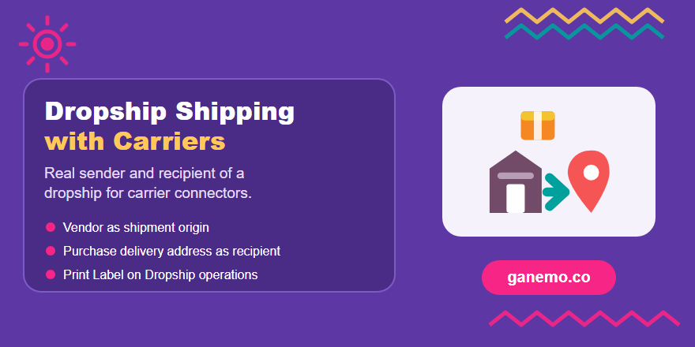

# **Dropship Shipping with Carriers** (`stock_delivery_dropship`)

**Author**: [Ganemo](https://www.ganemo.com)

## Producer product

Technical base module for carrier integrations on Odoo 18 (Inventory / Delivery). It is consumed by
carrier connector modules such as `delivery_sendcloud_dropship`; it adds no menus, models or settings.

## What it does

In a native Odoo 18 dropship (`stock_dropshipping`) the contact of the transfer is the **vendor**
(`purchase.order._prepare_picking`) and the real delivery address is the purchase `dest_address_id`.
Carrier connectors that read `picking.partner_id` and the warehouse of the operation type therefore
ship to the vendor from nowhere.

This module gives carrier connectors the real parties of a shipment:

| Method on `stock.picking` | Dropship | Other transfers |
|---|---|---|
| `_is_dropship_shipment()` | `True` (dropship type with a purchase) | `False` |
| `_is_customer_shipment()` | destination location is a customer location | same |
| `_get_shipping_destination_partner()` | purchase `dest_address_id` (falls back to the contact) | the contact |
| `_get_shipping_origin_partner()` | the purchase vendor | the warehouse address |

It also shows **Print Label** on the *Dropship* operation type form (Odoo only shows it for internal and
outgoing types).

**Optional: shipping method from the sale order.** Deliveries from the warehouse already get the shipping
method of the sale order (the *Propagate carrier* option of the route rules). Dropships do not: the purchase
creates them without shipping method. With **Use Sale Order Carrier** checked on the *Dropship* operation
type, the dropship gets the shipping method of the sale order when the purchase creates it; it can still be
changed on the transfer before validating. Unchecked (default): standard Odoo behaviour.

## Configuration and usage

1. Install the module (depends on `stock_delivery` and `stock_dropshipping`) and a carrier connector that
   uses the methods above.
2. Go to **Inventory > Configuration > Operation Types**, open **Dropship** and enable **Print Label**.
3. With the carrier integrated as *Get rate and create shipment* and *Print Label* set, Odoo sends the
   dropship to the carrier when it is validated, using the vendor as sender and the purchase delivery
   address as recipient.
4. Optional: on the same **Dropship** operation type, check **Use Sale Order Carrier** so dropships get the
   shipping method of the sale order.

The module does not create shipments by itself; the carrier connector does.

### Setup utilities (for setup and demo scripts)

Two helpers, meant to be called from scripts (XML `<function>`, shell, migrations):

- `stock.picking.type._setup_dropship_shipping(print_label=True, propagate_sale_carrier=True)`:
  configures the **Dropship** operation types of **all companies** at once (including archived
  ones): *Print Label* and *Use Sale Order Carrier*. Returns the ids of the types it changed.
- `purchase.order._confirm_dropship_purchases(sale_order_ids)`: confirms the draft purchases
  generated by those sale orders, which creates their dropships. Returns the ids of the purchases
  it confirmed.

## Demo data

Installed only with demo data, as a promotional products company whose vendors print and ship
straight to the customer:

- Vendors **Gràfiques Moianes** and **Papelera del Ebro**.
- Customers **Festival Mar i Música** (its delivery address has no email nor phone, so carrier
  integrations take them from the company) and **Bistrot du Port** (Dunkerque, France).
- Products with the dropship route and a vendor price: custom printed napkins and custom printed
  cotton tote bag.
- The shipping method **Missatgeria Vallès 24h** (fixed price, no integration).
- The *Dropship* operation type already configured (`_setup_dropship_shipping`).
- Two confirmed sales with the shipping method **Missatgeria Vallès 24h**, with their purchases
  confirmed (`_confirm_dropship_purchases`) and the dropships **ready**, carrying the shipping method
  of the sale.

## Manifest

- Version `18.0.1.1.0`, category `Inventory/Delivery`, license `OPL-1`, price USD 39.
- Depends on: `stock_delivery`, `stock_dropshipping`.
- Data: `views/stock_picking_type_views.xml`.

## Tests

`tests/test_dropship_shipping.py`: a sale with the dropship route creates the purchase and the dropship;
the helpers return the delivery address and the vendor; outgoing transfers keep the warehouse; the
operation type accepts *Print Label*; the dropship takes the shipping method of the sale only with
*Use Sale Order Carrier* (native behaviour otherwise, and no carrier if the sale has none); and the
demo dropships are ready with the carrier of the sale, the delivery address as recipient and the
vendor as sender.

## Cross-references

- Consumer: `delivery_sendcloud_dropship`.
- Website: <https://www.ganemo.com>
